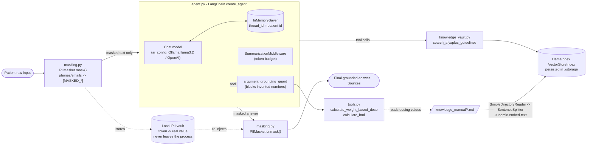

# AfyaPlus RAG-Powered Agent System

An audit-ready **medical insurance verification and clinical routing assistant** for
AfyaPlus Health, a *fictional* Kenyan health company (Week 2 capstone).

The assistant:

- answers insurance and clinic questions **only from local AfyaPlus documents** (RAG with LlamaIndex),
- does medical maths (weight-based doses, BMI) with **safe, validated tools**,
- **remembers each patient's conversation** separately (LangChain 1.x agent + LangGraph checkpointer),
- **hides Kenyan phone numbers and emails from the AI model** and puts them back only in the final answer.

It runs **free and fully local** with [Ollama](https://ollama.com) (`llama3.2` + `nomic-embed-text`),
and can switch to OpenAI by changing one line in `.env`.

> All documents in `knowledge_manual/` are **training examples, not medical advice**.

---

## Architecture



**Data flow for one message** (`src/main.py`):

1. **Mask** - `PIIMasker.mask()` swaps phones/emails for `[MASKED_PHONE_1]`, `[MASKED_EMAIL_1]`.
   Real values stay in a per-patient Python dict.
2. **Agent** - the masked text goes to the agent on the patient's `thread_id`. The agent calls
   tools and answers. It never sees real PII.
3. **Unmask** - `PIIMasker.unmask()` re-injects the real values into the approved answer.
4. **Print** - the demo also prints exactly what the AI saw and which tools ran (audit trail).

## Project layout

```
.
├── knowledge_manual/              # Source documents (fictional, training examples)
│   ├── insurance_cover_rules.md
│   ├── clinic_referral_rules.md
│   └── medication_dosing_reference.md
├── src/
│   ├── ai_config.py               # ONE switch: AI_PROVIDER=ollama|openai
│   ├── masking.py                 # PII masking middleware + de-masking + log filter
│   ├── knowledge_vault.py         # LlamaIndex build/load + @tool search_afyaplus_guidelines
│   ├── tools.py                   # @tool dose (grounded) + BMI calculators (validated, try/except)
│   ├── agent.py                   # create_agent + memory + guard + system prompt
│   └── main.py                    # mask -> agent -> unmask pipeline + demo / chat
├── tests/
│   ├── test_masking.py            # every Kenyan phone format + emails
│   ├── test_tools.py              # dose/BMI maths and error handling
│   └── test_agent_guard.py        # tool-argument grounding guard
├── storage/                       # generated vector index (git-ignored)
├── .env.example                   # config template (copy to .env)
├── requirements.txt
└── pytest.ini
```

## How to run

```bash
# 1. Install Ollama (https://ollama.com), then pull the two models
ollama pull llama3.2
ollama pull nomic-embed-text

# 2. Create the virtual environment and install dependencies
python3 -m venv venv
source venv/bin/activate            # Windows: venv\Scripts\activate
pip install -r requirements.txt

# 3. Configure
cp .env.example .env                # defaults already use Ollama

# 4. Run the scripted demo (2-turn memory proof + unanswerable question)
python src/main.py

#    ...or chat yourself
python src/main.py --chat

#    ...or force a fresh index after editing knowledge_manual/
python src/main.py --rebuild

# 5. Run the tests (no AI model needed)
pytest
```

**Switching to OpenAI:** in `.env` set `AI_PROVIDER=openai` and a real `OPENAI_API_KEY`.
Each provider gets its own index folder (`storage/ollama`, `storage/openai`) because vectors
from different embedding models cannot be mixed.

### Example demo output (abridged)

```
[patient-001] Turn 1 - patient shares PII and asks a cover question
  PATIENT >> Hello, I'm Wanjiru. My phone is 0712 345 678 and my email is wanjiru.kamau@example.co.ke. ...
  WHAT THE AI SAW : Hello, I'm Wanjiru. My phone is [MASKED_PHONE_1] and my email is [MASKED_EMAIL_1]. ...
  TOOLS CALLED    : search_afyaplus_guidelines({'query': 'Bronze plan annual outpatient limit and co-payment'})
  ASSISTANT >> ... the annual outpatient limit for the Bronze plan is KES 30,000. The co-payment ... is KES 500.
               Sources: insurance_cover_rules.md

[patient-001] Turn 2 - memory check (nothing repeated by the patient)
  WHAT THE AI SAW : Which plan did I say I'm on, and what phone number should the clinic call me on?
  AI REPLY (masked): You mentioned earlier that you're on the AfyaPlus Bronze plan. The clinic should call you on [MASKED_PHONE_1].
  ASSISTANT >> You mentioned earlier that you're on the AfyaPlus Bronze plan. The clinic should call you on 0712 345 678.

[patient-001] Turn 3 - RAG + maths tool
  TOOLS CALLED    : calculate_weight_based_dose({'medication': 'paracetamol', 'weight_kg': '18'})
  ASSISTANT >> ... paracetamol 270 mg per dose, syrup volume 11.2 mL, every 6 hours ...
               Sources: medication_dosing_reference.md

[patient-001] Turn 4 - question the documents cannot answer
  ASSISTANT >> Information not found in AfyaPlus guidelines
```

---

## Design choices

| Decision | Why |
|---|---|
| **LangChain 1.x `create_agent(..., system_prompt=...)`** | The current agent API; `AgentExecutor` / `initialize_agent` were removed in 1.x. Middleware hooks give us the guard and summarisation without a custom loop. |
| **`InMemorySaver` + one `thread_id` per patient** | Memory is isolated: patient-002 cannot see patient-001's history (shown in the demo). A production system would swap in a persistent, encrypted checkpointer (e.g. Postgres). |
| **One PII vault per patient** | The same number always maps to the same token across turns (`0712 345 678` and `+254712345678` share `[MASKED_PHONE_1]`), so memory stays consistent while the model never sees the real value. |
| **Two tools given to the agent** | `search_afyaplus_guidelines` + `calculate_weight_based_dose`. `calculate_bmi` exists and is tested in `tools.py`, but `llama3.2` kept inventing BMI calls on unrelated turns (40 blocked calls in one memory turn), so it was removed from the agent's tool list. Fewer tools = no tool confusion. |
| **Dose tool reads guideline values itself** | Early tests showed `llama3.2` (3B) skipping the lookup and passing invented values (e.g. concentration `120`). The tool now takes only `medication` + `weight_kg` and parses mg/kg, max dose and concentration from `medication_dosing_reference.md`, so clinical numbers can never come from the model. |
| **Loop limits** | `recursion_limit=12` steps and `ToolCallLimitMiddleware(run_limit=5)` per turn, `num_predict=1024`, 120 s timeout. LangGraph's default step limit is ~10,000, so a looping small model could otherwise hang the app (this happened in testing). |
| **`argument_grounding_guard` middleware** | Blocks a maths-tool call if any number in it was never typed by the patient (the model once invented a 55 kg / 150 cm BMI call). The call is returned as an `Error:` so the loop continues safely and the audit line shows `BLOCKED`. |
| **Two-layer "not found"** | (1) chunks below a similarity cutoff are discarded and, if none remain, the tool returns `Information not found in AfyaPlus guidelines` **without calling the LLM**; (2) the QA prompt forces that exact sentence when the retrieved text doesn't contain the answer. A final safety net in `agent.py` replaces the reply if the model ignores a not-found result. |
| **Deterministic citations** | Tool results end with `Sources: <file>`; if the model drops that line, `run_turn` re-attaches it. |
| **Defensive tools** | Every tool validates ranges (e.g. weight 0.5-350 kg, height 30-250 cm catches metres-vs-cm mistakes) and wraps work in `try/except`, returning `Error: ...` strings instead of raising. |
| **`temperature=0`** | Factual, repeatable answers. |

## Token management

| Setting | Value | Reasoning |
|---|---|---|
| `CHUNK_SIZE` | **256 tokens** | Roughly one guideline section per chunk. At 512 tokens the whole manual collapsed into 4 chunks (about one per file) and an off-topic question still scored 0.65; at 256 we get 9 focused chunks and retrieval lands on the exact section (e.g. the paracetamol syrup line scores 0.77). |
| `CHUNK_OVERLAP` | **40 tokens (~15%)** | A rule that straddles a chunk boundary still appears whole in one chunk, without duplicating much text. |
| `TOP_K` | **3** | 3 × 256 ≈ 770 context tokens per lookup: enough to cover a question that spans two sections, small enough for a 3B local model to read accurately. |
| `SIMILARITY_CUTOFF` | **0.50** | Measured: unrelated questions (e.g. "Who won the 2022 World Cup?") topped out at 0.46; real questions scored 0.58-0.78. |
| `OLLAMA_NUM_CTX` | **8192** | `llama3.2` defaults to a 131k context that needs ~18 GB RAM and spilled 39% onto the CPU on a 16 GB laptop (lookups timed out). Our prompts stay under ~4k tokens, so 8k runs 100% on the GPU in ~3 GB. |
| `SummarizationMiddleware` | trigger **3,000 tokens**, keep last **6 messages** | Long conversations are condensed automatically so the prompt never outgrows the context window. Summaries are written from already-masked text. |
| Persisted index | `./storage/<provider>/` + fingerprint | Embeddings are computed once. A SHA-256 fingerprint of the documents + chunk settings + embedding model triggers a rebuild only when something changes. |

I also tried returning the raw retrieved excerpts from the guidelines tool. It added about 750
tokens per call to the chat history, and the 3B model then lost track of earlier turns (the
memory test failed), so it was reverted. Keeping tool outputs short is part of the token budget.

## Privacy safeguards (Kenya Data Protection Act, 2019)

AfyaPlus handles **health data**, which the Act treats as *sensitive personal data*. The design
applies the Act's principles in code:

| Principle (KDPA 2019) | How this system applies it |
|---|---|
| **Data minimisation** (s.25: data must be adequate, relevant and limited to what is necessary) | The AI model only receives masked text. It never needs a patient's phone or email to answer a policy question, so it never gets one. |
| **Data protection by design and by default** (s.41) | Masking is not optional or per-feature: `main.py` routes *every* message through `PIIMasker.mask()` before the agent, and through `unmask()` only at the final output step. |
| **Security of processing / confidentiality** | Real values live only in an in-process Python dict (the vault). They are never written to disk, never placed in the vector index, and never sent to the model. |
| **Mask at every exit, including logs** | `PIIRedactingFilter` is attached to the log handler, so any phone or email that reaches a log line is replaced with `[REDACTED_PHONE]` / `[REDACTED_EMAIL]` (tested in `test_masking.py`). Tool errors log only the exception type. |
| **Cross-border transfer** (Part VI, ss.48-50) | The default Ollama mode keeps all processing on the local machine, inside Kenya. In OpenAI mode, data leaves the country, but only in masked form; a real deployment would still need a transfer assessment. |
| **Accuracy** | Answers are grounded in approved documents with source citations, and doses come from deterministic code, which reduces the risk of giving a patient wrong information. |

**What the masking regex covers:** `07xx` / `01xx` local numbers and `+254` / `254` international
numbers, written together, with spaces, or with hyphens (`0712345678`, `0712 345 678`,
`0712-345-678`, `+254712345678`, `254 712 345 678`, `+254110345678`), plus emails. A full stop
after an email is never captured, and digits inside an email are not mistaken for a phone.

### Known limitations / next steps

- **Names, national ID and policy numbers are not masked** (only phones and emails are in scope).
  The demo shows "Wanjiru" reaching the model. Next step: add a NER-based name detector and a
  Kenyan ID pattern.
- The vault and the conversation memory are **in-memory**: both are lost when the process stops.
  Production would use an encrypted store with retention limits and a right-to-erasure path.
- `llama3.2` is a 3B model: it sometimes makes unnecessary tool calls, adds odd remarks (e.g. that a number is "masked"), or answers patient-002's memory question with the not-found message. It never leaks another patient's data. The guard and the
  safety nets keep these harmless, and switching `AI_PROVIDER` to a larger model improves this.
